<div align="center">

# 🍽️ Delicious Food · Sistema de Costos Estándar

### Conoce cuánto *debería* costar cada producto, compáralo con lo que *de verdad* costó y descubre **dónde se va tu ganancia**.

[](https://cost-system-wine.vercel.app/)
[](https://github.com/BeniaminoC/cost-system/releases/latest)
[](https://github.com/BeniaminoC/cost-system)

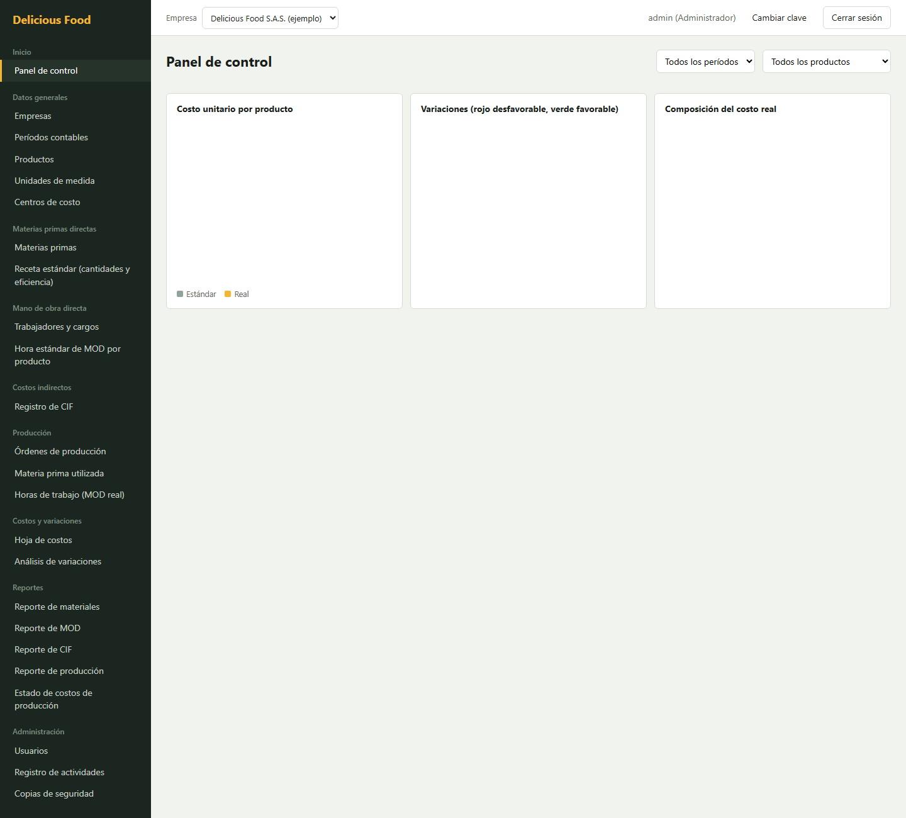

<sub>Las capturas de esta guía usan los datos de ejemplo de una empresa de comida rápida (arepas, perros calientes y suizos).</sub>

</div>

---

## 🧭 Contenido

1. [Qué hace el sistema](#1--qué-hace-el-sistema)
2. [Elige cómo usarlo: web o en tu computador](#2--elige-cómo-usarlo-web-o-en-tu-computador)
3. [🌐 Versión web (la más fácil)](#3--versión-web-la-más-fácil)
4. [💻 Versión local en Windows (instalador del Release)](#4--versión-local-en-windows-instalador-del-release)
5. [Otras formas de abrirlo en local (con Python)](#5--otras-formas-de-abrirlo-en-local-con-python)
6. [Entrar y proteger tu cuenta](#6--entrar-y-proteger-tu-cuenta)
7. [Tu primera vez: la ruta paso a paso](#7--tu-primera-vez-la-ruta-paso-a-paso)
8. [Cómo leer los resultados](#8--cómo-leer-los-resultados)
9. [Reportes y exportación](#9--reportes-y-exportación)
10. [Usuarios, roles y registro de actividad](#10--usuarios-roles-y-registro-de-actividad)
11. [Copias de seguridad (y cómo pasar datos entre local y web)](#11--copias-de-seguridad-y-cómo-pasar-datos-entre-local-y-web)
12. [Cómo sacarle el máximo provecho](#12--cómo-sacarle-el-máximo-provecho)
13. [Si algo falla](#13--si-algo-falla)
14. [Más información y archivos de ayuda](#14--más-información-y-archivos-de-ayuda)

---

## 1 · Qué hace el sistema

Casi todos los negocios saben cuánto venden. Pocos saben cuánto les cuesta **de verdad** cada producto. Este sistema responde tres preguntas:

| Pregunta | Qué te da el sistema |
|---|---|
| **¿Cuánto debería costar?** | El **costo estándar** de cada producto, armado con tres elementos: **materiales** (con su desperdicio), **mano de obra directa** y **costos indirectos de fabricación (CIF)**. |
| **¿Cuánto costó de verdad?** | Las **órdenes de producción**: registras lo que realmente se usó (materiales, horas y CIF) y el sistema calcula el **costo real**. |
| **¿Por qué costó distinto?** | **Seis variaciones** que separan la diferencia en causas concretas (precio, cantidad, tarifa, eficiencia, presupuesto y volumen) para que sepas **qué corregir**. |

**También incluye:** varias empresas y períodos contables, panel con gráficos, 7 reportes con exportación a **Excel y PDF**, usuarios con roles, registro de todo lo que se hace, y **copias de seguridad** en un archivo `.json`.

> [!IMPORTANT]
> El sistema calcula costos estándar y variaciones con **los datos que tú cargas**. **No reemplaza a un contador**: no hace contabilidad general, nómina ni declaraciones, y sus resultados no son asesoría contable ni tributaria.

---

## 2 · Elige cómo usarlo: web o en tu computador

El **mismo programa** funciona de dos maneras. Escoge la que te quede más cómoda:

| | 🌐 **Versión web** | 💻 **Versión local (Windows)** |
|---|---|---|
| **Dificultad** | ⭐ **La más fácil**: abres un enlace y listo | ⭐⭐ Descargas un instalador y lo ejecutas |
| **Qué necesitas** | Un navegador e internet | Un computador con Windows e instalar el programa (sin internet para usarlo) |
| **Dónde quedan tus datos** | En una base de datos en internet (MySQL en Aiven) | En un archivo dentro de tu computador (`delicious_food.db`) |
| **Usuarios de fábrica** | Solo `admin`, con la clave que definió quien publicó el sistema | `admin`, `usuario` y `estudiante` (claves públicas: **cámbialas**) |
| **Ideal para** | Probarlo ya, usarlo desde el celular o compartirlo con un equipo | Trabajar sin internet y mantener los datos en tu equipo |
| **Dónde está** | **[cost-system-wine.vercel.app](https://cost-system-wine.vercel.app/)** | **[Releases del repositorio](https://github.com/BeniaminoC/cost-system/releases/latest)** |

> [!NOTE]
> Son **dos bases de datos separadas**: lo que captures en la web no aparece en tu computador, ni al revés. Si quieres pasar la información de un lado al otro, usa las [copias de seguridad](#11--copias-de-seguridad-y-cómo-pasar-datos-entre-local-y-web).

---

## 3 · 🌐 Versión web (la más fácil)

No tienes que descargar ni instalar nada.

1. Abre **<https://cost-system-wine.vercel.app/>** en Chrome, Edge o Firefox (también sirve desde el celular).
2. Escribe tu **usuario** y **contraseña** y pulsa **Entrar**.

<p align="center">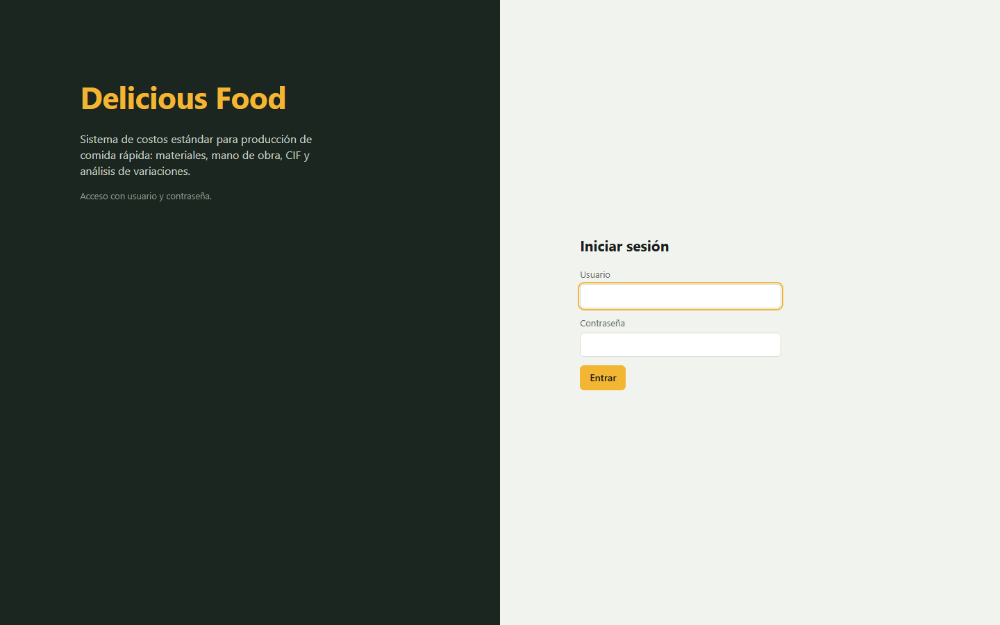</p>

3. Listo: verás el **Panel de control**. Si el sistema es nuevo, ya trae una empresa de ejemplo para que explores.

<p align="center">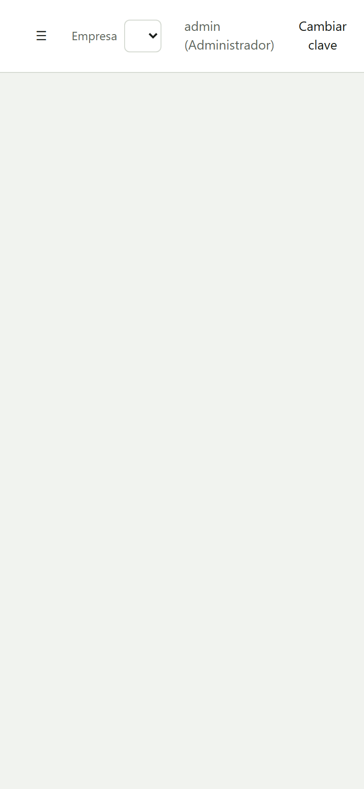</p>
<p align="center"><sub>El mismo sistema desde el navegador del celular.</sub></p>

**Lo que debes saber de la versión web**

- **La primera carga puede tardar unos segundos** (10 a 30): el servicio se "despierta" y, si es la primera vez, crea sus tablas. Si ves un error de «tiempo agotado», espera un minuto y recarga.
- **Solo existe el usuario `admin`.** El administrador crea a los demás en **Administración → Usuarios**. La contraseña de `admin` la define quien publicó el sistema (no está escrita en esta guía por seguridad). Pídesela a esa persona.
- La sesión se cierra sola tras **60 minutos** sin actividad.
- Si el sistema dice **«No se pudo conectar con la base de datos»**, el servicio gratuito de la base pudo apagarse por inactividad. Quien lo administra debe encenderlo desde Aiven (botón *Power on*).
- El sistema web **no hace copias automáticas**: descarga una copia de vez en cuando (ver [sección 11](#11--copias-de-seguridad-y-cómo-pasar-datos-entre-local-y-web)).

> [!TIP]
> ¿Quieres publicar tu propia versión web? Sigue la guía paso a paso en [`docs/DESPLIEGUE_VERCEL.md`](docs/DESPLIEGUE_VERCEL.md) (también en Word: [`docs/DESPLIEGUE_VERCEL.docx`](docs/DESPLIEGUE_VERCEL.docx)). Usa tres servicios gratuitos: **GitHub** (código), **Aiven** (base de datos) y **Vercel** (el enlace).

---

## 4 · 💻 Versión local en Windows (instalador del Release)

El archivo para instalar el programa en tu computador **no está en el código del repositorio: está en la sección *Releases***. Con él **no necesitas instalar Python** ni nada más.

### Paso 1 · Descarga el instalador

1. Abre la página de Releases: **<https://github.com/BeniaminoC/cost-system/releases/latest>** (versión *1.0.0 – Instalador*).
2. Baja hasta la sección **Assets**.
3. Descarga el archivo del instalador, el `.exe` (por ejemplo `DeliciousFoodCostos_Setup.exe`).

<p align="center">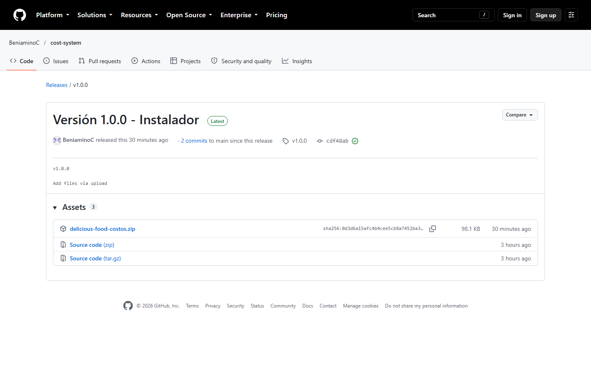</p>

> [!WARNING]
> **No descargues** los archivos que dicen **«Source code (zip)»** ni **«Source code (tar.gz)»**, ni uses el botón verde **Code → Download ZIP**. Esos traen el *código fuente* del proyecto, no el instalador. Para usar el programa, baja siempre el `.exe` desde **Assets**.

### Paso 2 · Ejecuta el instalador

1. Haz **doble clic** sobre el `.exe` descargado.
2. Si Windows muestra una pantalla azul de **«Windows protegió su PC»** (SmartScreen), es porque el instalador no está firmado digitalmente. Pulsa **Más información → Ejecutar de todas formas**. Hazlo solo si lo descargaste del Release oficial de este repositorio.
3. Sigue el asistente (**Siguiente → Instalar**). No pide permisos de administrador: se instala dentro de tu usuario.
4. Deja marcada la casilla **«Iniciar el sistema ahora»** y pulsa **Finalizar**.

El instalador crea un acceso directo **«Sistema de Costos»** en el **Escritorio** y en el **Menú Inicio** (carpeta *Delicious Food*).

### Paso 3 · Abre el sistema

Al abrir el acceso directo aparece una **ventana negra** (es el "motor" del programa) y, un segundo después, **tu navegador se abre solo** en `http://127.0.0.1:8080`:

```text
  Delicious Food - Sistema de Costos
  Sistema en ejecución: http://127.0.0.1:8080
  (Cierre esta ventana para detener el sistema)
```

> [!IMPORTANT]
> **Deja la ventana negra abierta mientras uses el sistema.** Si la cierras, el sistema se detiene. Cerrar solo el navegador **no** lo apaga. Para volver a entrar, abre de nuevo el acceso directo o escribe `http://127.0.0.1:8080` en el navegador mientras la ventana siga abierta.

Entra con `admin` / `admin123` y **cambia la contraseña de inmediato** ([sección 6](#6--entrar-y-proteger-tu-cuenta)).

### ¿Dónde quedan mis datos?

En un solo archivo: **`data\delicious_food.db`**, dentro de la carpeta donde se instaló el programa. Ese archivo es **tu base de datos completa**: no se envía a ningún sitio y no viaja con el instalador.

> [!CAUTION]
> **Antes de desinstalar o actualizar el programa, descarga una copia de seguridad** (Administración → Copias de seguridad → *Descargar copia ahora*). Así no dependes de que el archivo de datos se conserve y puedes recuperar todo con **Restaurar**.

---

## 5 · Otras formas de abrirlo en local (con Python)

Si prefieres no usar el instalador (o estás en Linux o Mac), puedes ejecutar el programa directamente desde el código.

| Necesitas | Detalle |
|---|---|
| **Python 3.9 o superior** | Descárgalo de <https://www.python.org/downloads/>. En Windows, al instalar, marca **«Add python.exe to PATH»**. Comprueba con `python --version`. |
| **Nada más** | El modo local usa solo la biblioteca estándar de Python: **no hay que instalar librerías ni una base de datos**. |
| **Un navegador actualizado** | Chrome, Edge o Firefox. |

1. En la página del repositorio pulsa **Code → Download ZIP** y descomprímelo en una carpeta fija (por ejemplo `C:\costos`). *Evita «Archivos de programa» y carpetas sincronizadas con OneDrive o Dropbox.*
2. **Windows:** doble clic en **`iniciar.bat`**. **Linux o Mac:** en la terminal, `./iniciar.sh`.
3. Se abre el navegador en `http://127.0.0.1:8080`.

Si Windows dice que «python» no se reconoce, reinstala Python marcando *Add python.exe to PATH*.

---

## 6 · Entrar y proteger tu cuenta

**Usuarios de fábrica de la versión local** (en la web solo existe `admin`):

| Usuario | Contraseña | Rol | Qué puede hacer |
|---|---|---|---|
| `admin` | `admin123` | **Administrador** | Todo: crear, editar y eliminar datos, administrar usuarios, ver la actividad y hacer copias de seguridad. |
| `usuario` | `usuario123` | **Usuario** | Consultar, crear y editar datos de costos. No elimina ni administra usuarios. |
| `estudiante` | `estudiante123` | **Estudiante** | Solo consulta, reportes y exportación. |

> [!WARNING]
> Estas contraseñas son **públicas** (están en esta misma guía). **Cámbialas apenas entres**: botón **«Cambiar clave»**, arriba a la derecha (mínimo 6 caracteres).

**Lo que debes saber de la sesión**

- Tras **5 intentos fallidos**, el usuario se bloquea **1 minuto**.
- La sesión se cierra sola tras **60 minutos** sin actividad. Si ves «Su sesión expiró», entra de nuevo.
- Las contraseñas se guardan cifradas (PBKDF2-SHA256 con sal); nadie, ni el administrador, puede verlas.

**¿Olvidaste la contraseña?**

- Si es de **otro usuario**: el administrador la cambia en **Administración → Usuarios → Editar**.
- Si es la de **`admin` en local**: restaura una copia de seguridad que tengas, o borra `data\delicious_food.db` con el sistema cerrado (⚠️ se pierde la información y se crea una base nueva).
- Si es la de **`admin` en la web**: sigue la sección *«Si no puedes entrar»* de [`docs/DESPLIEGUE_VERCEL.md`](docs/DESPLIEGUE_VERCEL.md).

---

## 7 · Tu primera vez: la ruta paso a paso

El sistema ya incluye una **empresa de ejemplo** («Delicious Food S.A.S.») con 3 productos, materias primas, trabajadores, CIF y 12 órdenes, para que puedas explorar de inmediato. Cuando quieras trabajar con tus propios datos, **sigue este orden**: cada paso usa lo del anterior.

<p align="center">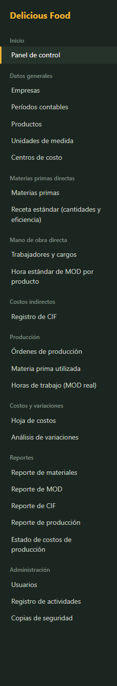</p>

| # | Módulo (menú lateral) | Para qué sirve |
|---|---|---|
| 1 | **Empresas** | Datos de tu negocio |
| 2 | **Períodos contables** | El mes (o lapso) en que vas a costear |
| 3 | **Unidades de medida** y **Centros de costo** | Catálogos de apoyo (ya vienen unidades básicas) |
| 4 | **Materias primas** | Lo que compras y cuánto cuesta |
| 5 | **Trabajadores y cargos** | Quién produce y a cuánto sale su hora |
| 6 | **Productos** | Lo que vendes y a qué precio |
| 7 | **Receta estándar** | Cuánto de cada materia prima lleva *una* unidad |
| 8 | **Hora estándar de MOD por producto** | Cuánto tarda *una* unidad |
| 9 | **Registro de CIF** | Costos indirectos del período |
| 10 | **Órdenes de producción** (+ materia prima utilizada + horas de trabajo) | Lo que realmente pasó |
| 11 | **Panel**, **Hoja de costos**, **Análisis de variaciones** | La lectura de resultados |

> [!NOTE]
> ¿Quieres saber para qué sirve **cada apartado** del menú antes de empezar? Al final de esta sección está el **mapa completo del menú**, con todos los apartados explicados.

> [!TIP]
> Cada módulo tiene los botones **Nuevo**, **Editar** y **Eliminar**, y un buscador. El sistema **valida** todo lo que escribes (campos obligatorios, números válidos, fechas coherentes, códigos no repetidos) y te explica en español qué corregir.

### Paso 1 · Crea tu empresa
**Menú Datos generales → Empresas → Nueva.** NIT, razón social, nombre comercial, régimen tributario (*Responsable de IVA*, *No responsable de IVA* o *Régimen simple*), tarifa de IVA, retención, actividad económica (CIIU), dirección, ciudad, teléfono y correo. Arriba, en el selector **Empresa**, eliges con cuál trabajas (puedes tener varias).

<p align="center">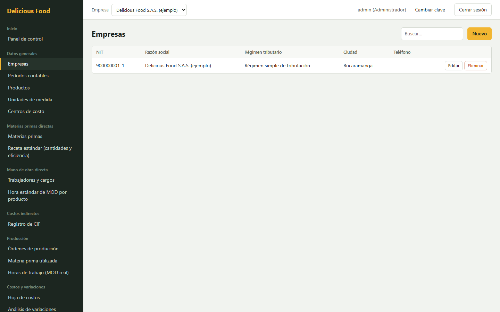</p>

### Paso 2 · Crea un período contable
**Períodos contables → Nuevo.** Código (por ejemplo `2026-10`), fechas de inicio y fin, y **estado** (*Abierto* o *Cerrado*).

<p align="center">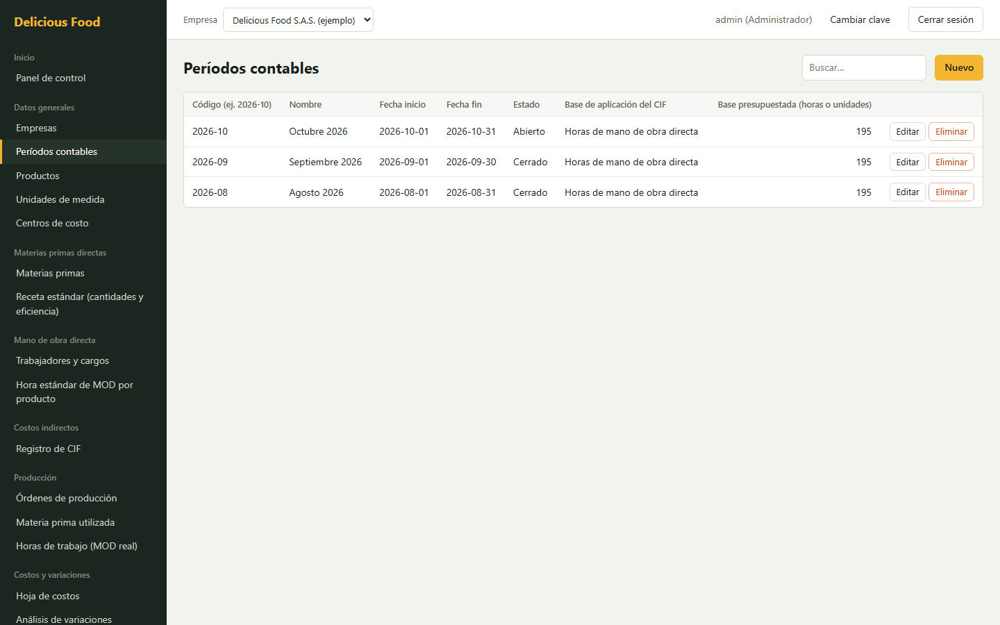</p>

Dos datos clave para repartir los costos indirectos:

- **Base de aplicación del CIF:** *Horas de mano de obra directa* o *Unidades producidas*. Es el criterio con el que se reparte el CIF entre los productos.
- **Base presupuestada:** cuántas horas (o unidades) esperas en el período. Con 0 el reparto sale mal.

> [!NOTE]
> Un período **cerrado** bloquea el registro de órdenes y CIF nuevos. Ábrelo de nuevo si necesitas modificarlo.

### Paso 3 · Unidades de medida y centros de costo
- **Unidades de medida:** ya incluye pieza, porción, kilo, libra, gramo, litro, mililitro, onza, galón, metro cúbico, rollo y hora. Agrega las que falten.
- **Centros de costo:** áreas del negocio, de tipo *Productivo*, *Servicio* o *Administrativo* (por ejemplo «Cocina – Producción»).

<p align="center">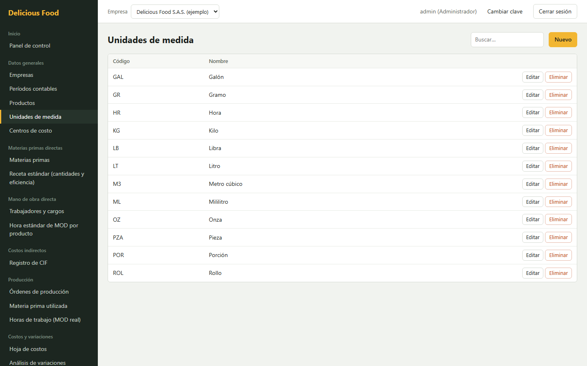 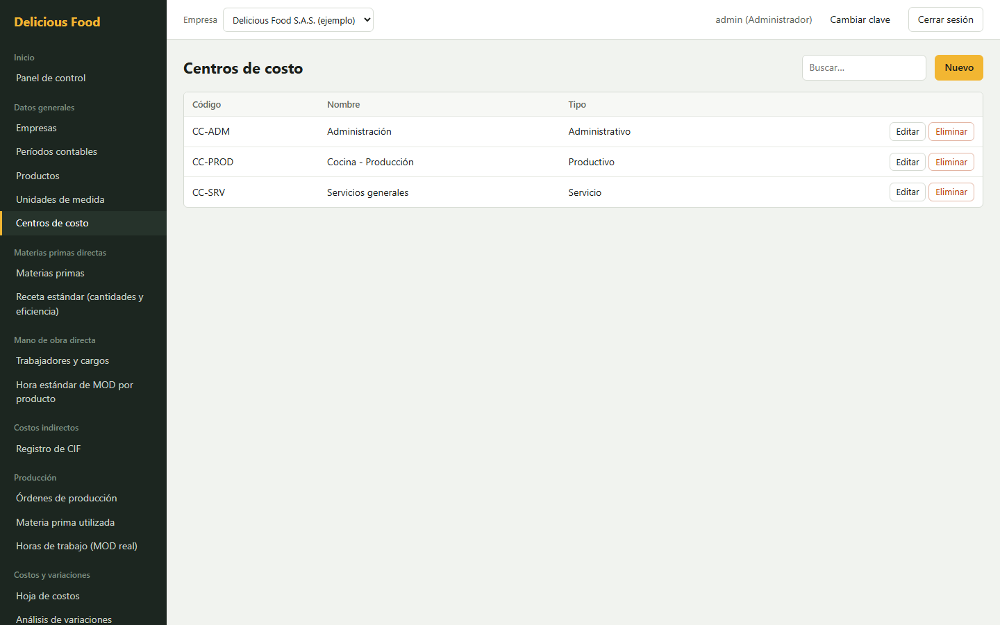</p>

### Paso 4 · Registra tus materias primas
**Materias primas directas → Materias primas → Nueva.**

<p align="center">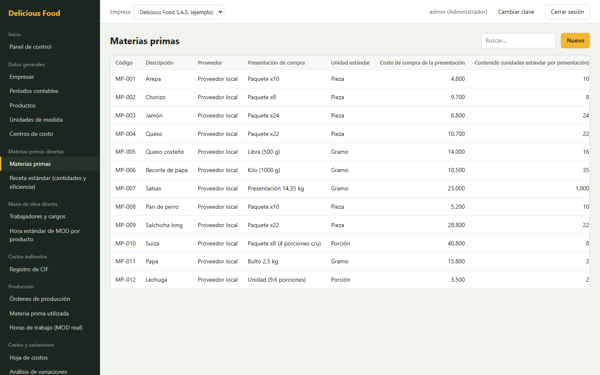</p>

| Campo | Qué poner |
|---|---|
| **Presentación de compra** | Cómo la compras (ej. «Paquete x10») |
| **Unidad estándar** | En qué la usas (pieza, gramo, porción…) |
| **Costo de compra de la presentación** | Lo que pagas por el paquete completo |
| **Contenido** | Cuántas unidades estándar trae esa presentación |
| **% de merma** y **% costo logístico** | Desperdicio y fletes/almacenamiento, si aplican |

El sistema calcula solo el **costo estándar por unidad**:

```text
costo estándar = costo de compra ÷ contenido × (1 + merma%) × (1 + logística%)
```

*Ejemplo: un paquete de 10 arepas a $4.800 → $480 por arepa.*

Así se ve el formulario al pulsar **Nueva**:

<p align="center">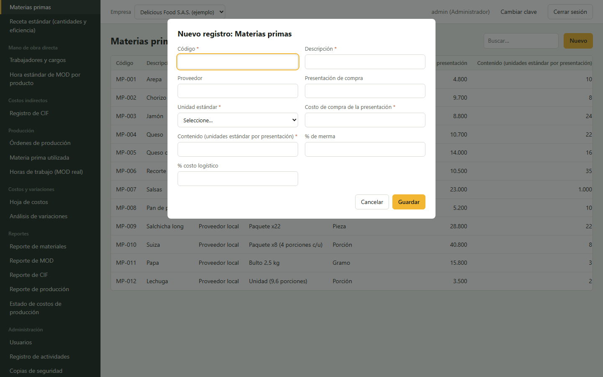</p>

### Paso 5 · Registra la mano de obra
**Mano de obra directa → Trabajadores y cargos → Nuevo.** Salario mensual, **prestaciones sociales %**, **cargas laborales %** y **horas estándar por mes**.

<p align="center">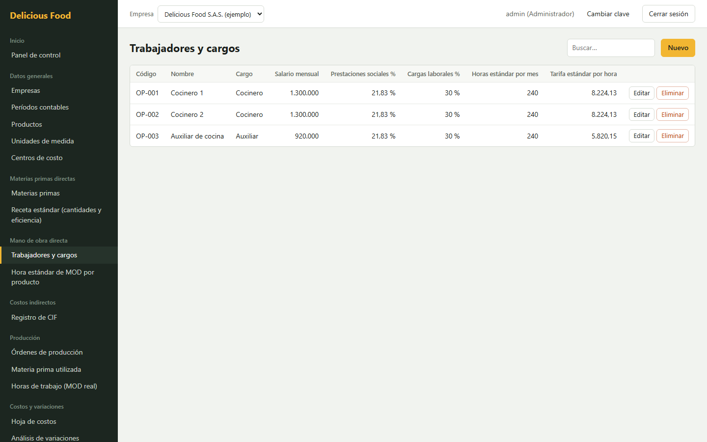</p>

```text
tarifa por hora = salario × (1 + prestaciones% + cargas%) ÷ horas del mes
```

> [!TIP]
> Registra **solo a quienes producen**. Las horas por mes son las de **un mes** (unas 192–240), no las de la semana.

### Paso 6 · Crea tus productos
**Datos generales → Productos → Nuevo.** Código, nombre, unidad de medida, **precio de venta** y centro de costo. El precio de venta se usa después para calcular las ventas y el margen del Panel.

<p align="center">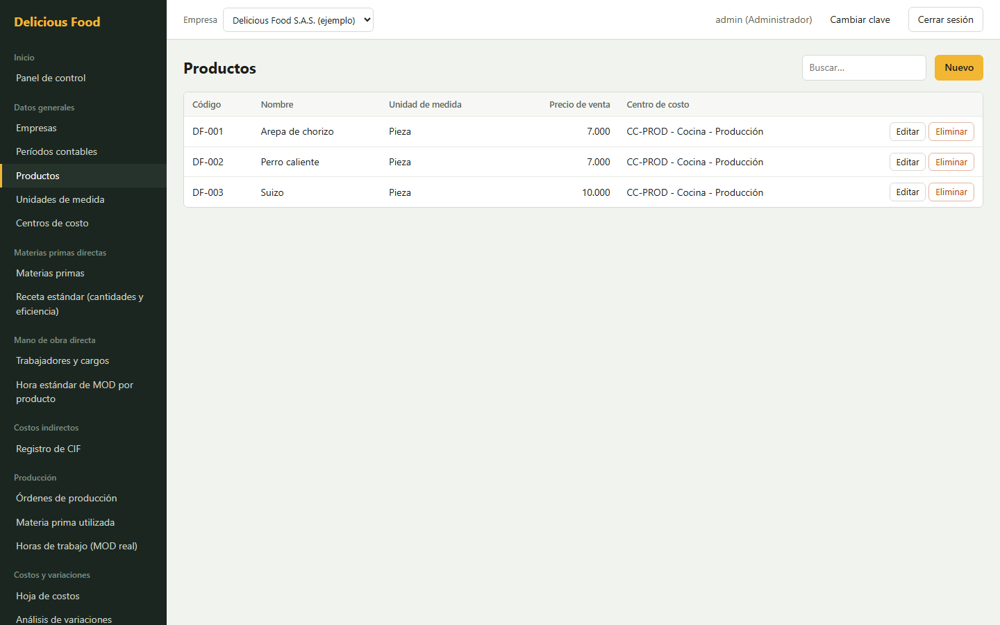</p>

### Paso 7 · Arma la receta estándar
**Materias primas directas → Receta estándar → Nueva.** Para cada producto agrega cada materia prima con:

- **Cantidad estándar por unidad:** cuánto lleva *una* unidad del producto.
- **Eficiencia %:** `100` = sin desperdicio. Con `95`, el 5 % se pierde y el sistema lo suma al costo.

<p align="center">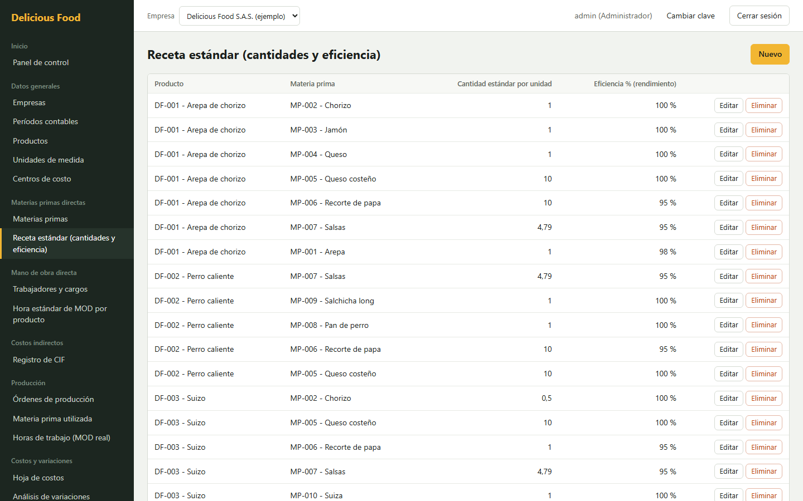</p>

### Paso 8 · Define la hora estándar de mano de obra
**Mano de obra directa → Hora estándar de MOD por producto → Nueva.** Producto, trabajador/cargo y **horas estándar por unidad**.

<p align="center">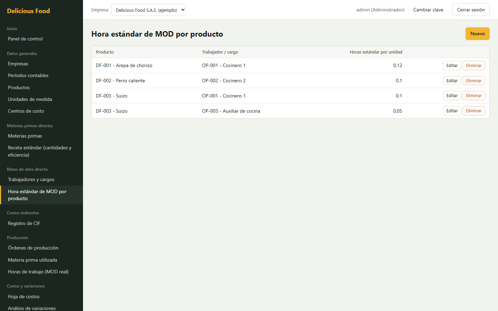</p>

> [!WARNING]
> Esas horas son el tiempo de **UNA sola unidad**, no el de toda la tanda. Si 30 piezas se hacen en 15 minutos: 15 ÷ 30 ÷ 60 = **0,0083 horas** por pieza. Poner el tiempo de la tanda infla la mano de obra y todo parece pérdida.

### Paso 9 · Registra los costos indirectos (CIF)
**Costos indirectos → Registro de CIF → Nuevo.** Período, código, descripción (arriendo, gas, energía, empaques…), **tipo** (*Fijo* o *Variable*), centro de costo, **CIF presupuestado** y **CIF real**.

<p align="center">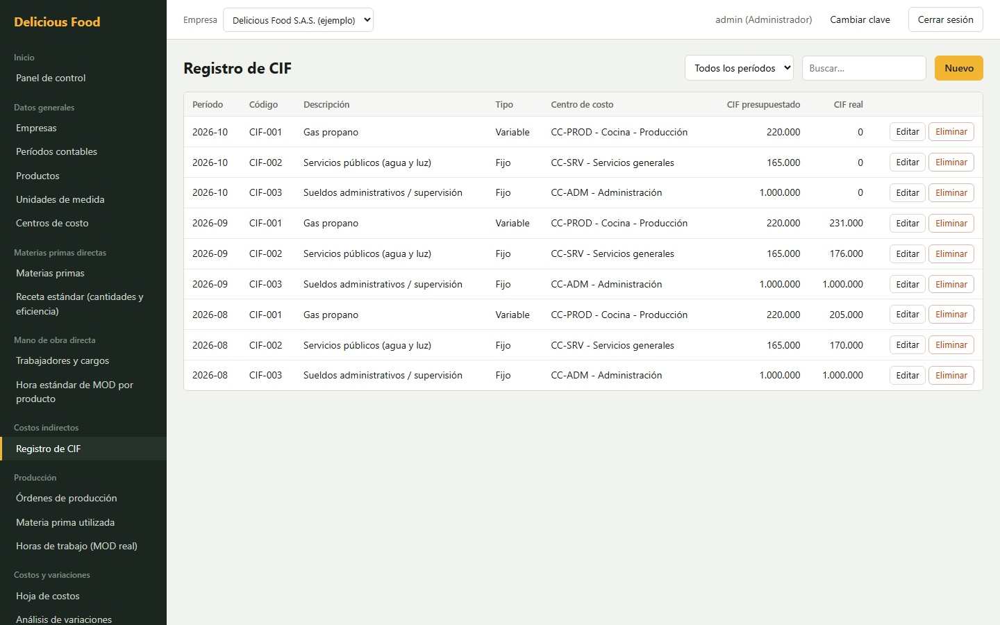</p>

El sistema calcula la **tasa predeterminada** del período:

```text
tasa = CIF presupuestado ÷ base presupuestada (horas de MOD o unidades)
```

### Paso 10 · Registra una orden de producción
Una orden se registra en **tres pantallas**, todas en el menú **Producción**:

1. **Órdenes de producción → Nueva:** número, período, producto, fecha (dentro del período), cantidad planeada, **cantidad terminada**, **cantidad en proceso**, **% de avance** de lo que está en proceso y estado (*Abierta* / *Cerrada*).
2. **Materia prima utilizada:** por orden y materia prima, la **cantidad real** usada y el **precio real** pagado.
3. **Horas de trabajo (MOD real):** por orden y trabajador, las **horas reales** y la **tarifa real**.

<p align="center">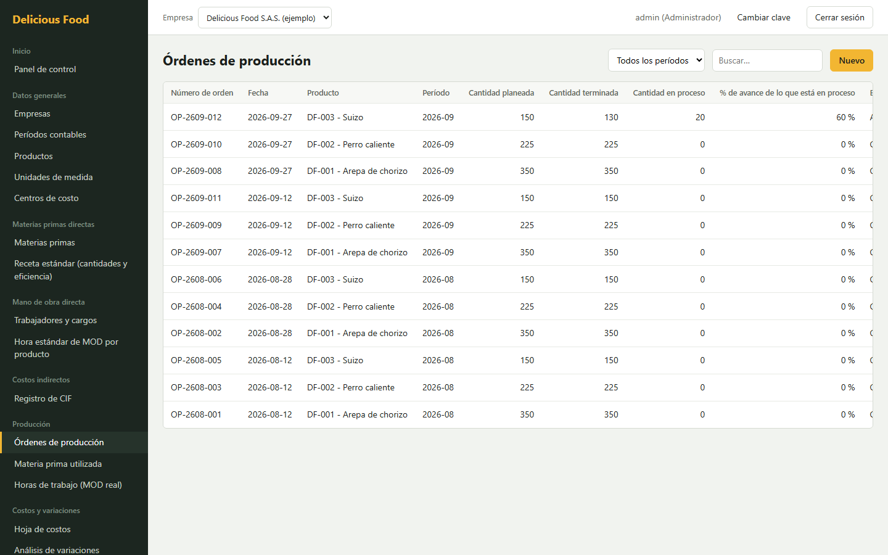</p>

**Materia prima utilizada** (lo que realmente se gastó en cada orden):

<p align="center">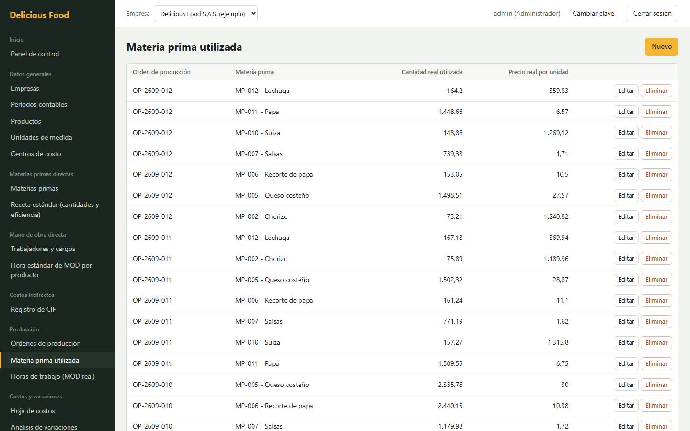</p>

**Horas de trabajo (MOD real)** (las horas que realmente se trabajaron en cada orden):

<p align="center">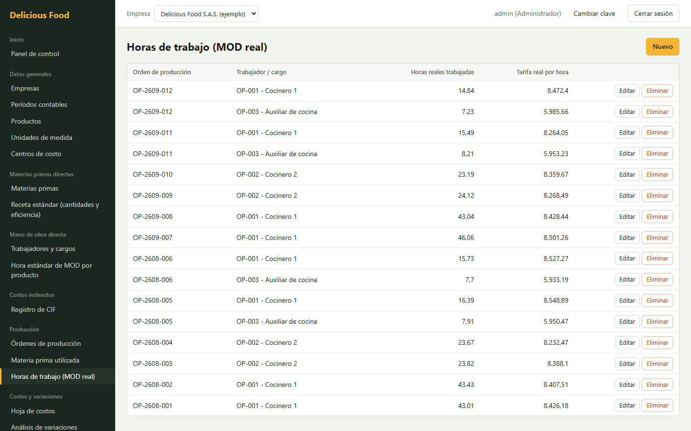</p>

> [!WARNING]
> Las variaciones solo son representativas cuando la orden tiene registrados **todos** sus consumos reales (materiales **y** horas). Una orden con datos parciales mostrará variaciones favorables artificiales.

Cada vez que guardas un cambio, el sistema **recalcula todo automáticamente**: costos estándar, costos reales y variaciones.

---

### 🗺️ Mapa completo del menú: qué hay en cada apartado

Esta es la referencia rápida de **todos los apartados** del menú lateral, en el mismo orden en que aparecen. La idea general es sencilla: lo que cargas en los apartados *estándar* (materias primas, recetas, mano de obra y CIF) define **cuánto debería costar**; lo que cargas en *Producción* dice **cuánto costó de verdad**; y los apartados de *resultados* comparan ambos.

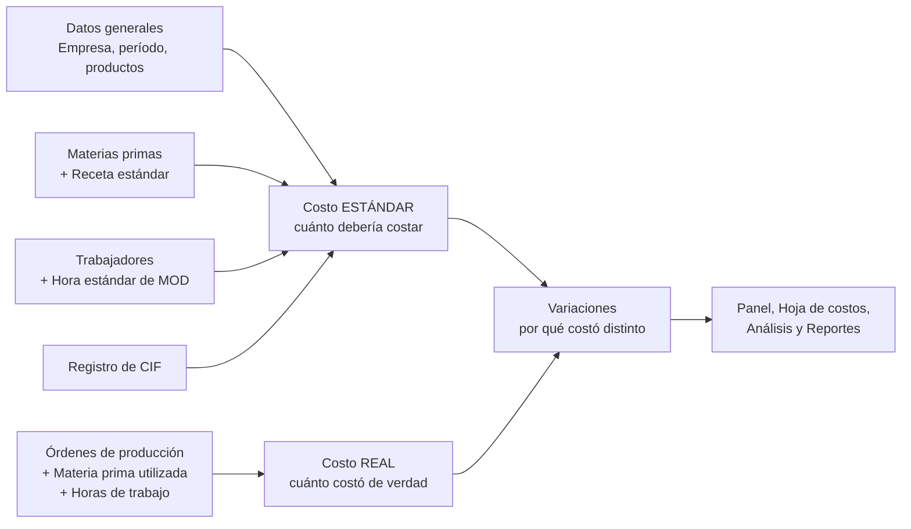

#### 🏠 Inicio

| Apartado | Para qué sirve | Qué verás o registrarás |
|---|---|---|
| **Panel de control** | Pantalla de inicio: un vistazo al estado de tus costos. | Indicadores (costo estándar vs. real, variaciones, ventas y margen) y tres gráficos. Se filtra por período y producto. Detalle en la [sección 8](#8--cómo-leer-los-resultados). |

#### 🗂️ Datos generales
*Catálogos base. Se crean primero porque el resto de los apartados se apoya en ellos.*

| Apartado | Para qué sirve | Qué verás o registrarás |
|---|---|---|
| **Empresas** | El negocio para el que se calculan los costos. | NIT, razón social, nombre comercial, régimen tributario, IVA, retención, CIIU, dirección y contacto. El selector **Empresa** (arriba) define con cuál trabajas. |
| **Períodos contables** | El lapso (normalmente un mes) que se va a costear. | Código, fechas de inicio y fin, estado (*Abierto* o *Cerrado*), **base de aplicación del CIF** y **base presupuestada**. Un período cerrado bloquea órdenes y CIF nuevos. |
| **Productos** | Lo que vendes. | Código, nombre, unidad de medida, **precio de venta** y centro de costo. El precio alimenta las ventas y el margen del Panel. |
| **Unidades de medida** | Catálogo de unidades (pieza, porción, kilo, gramo, litro, hora…). | Ya vienen las básicas; agrega las que falten. Se usan al definir materias primas y productos. |
| **Centros de costo** | Las áreas del negocio donde se generan los costos. | Nombre y tipo (*Productivo*, *Servicio* o *Administrativo*), por ejemplo «Cocina – Producción». Se asignan a productos y a registros de CIF. |

#### 🥩 Materias primas directas
*Los materiales que se convierten en producto y cuánto lleva cada unidad.*

| Apartado | Para qué sirve | Qué verás o registrarás |
|---|---|---|
| **Materias primas** | La lista de insumos con su costo. | Presentación de compra, unidad estándar, costo de compra, contenido, % de merma y % de costo logístico. El sistema calcula el **costo estándar por unidad**. |
| **Receta estándar (cantidades y eficiencia)** | Cuánto de cada materia prima lleva **una** unidad de producto. | Por producto y materia prima: cantidad estándar por unidad y **eficiencia %** (100 = sin desperdicio). Define el costo estándar de los materiales. |

#### 👷 Mano de obra directa
*Quién produce y cuánto tiempo toma cada producto.*

| Apartado | Para qué sirve | Qué verás o registrarás |
|---|---|---|
| **Trabajadores y cargos** | Las personas que producen y cuánto cuesta su hora. | Salario mensual, prestaciones %, cargas laborales % y horas estándar por mes. De ahí sale la **tarifa por hora**. |
| **Hora estándar de MOD por producto** | El tiempo que toma **una** unidad de cada producto. | Producto, trabajador o cargo y horas por unidad. Multiplicadas por la tarifa dan el costo estándar de mano de obra. |

#### 🏭 Costos indirectos

| Apartado | Para qué sirve | Qué verás o registrarás |
|---|---|---|
| **Registro de CIF** | Los costos indirectos de fabricación: arriendo, gas, energía, empaques… | Período, código, descripción, tipo (*Fijo* o *Variable*), centro de costo, CIF **presupuestado** y CIF **real**. De aquí sale la tasa de aplicación del período. |

#### 📦 Producción
*Lo que realmente pasó. Se captura en orden: primero la orden y después sus dos detalles.*

| Apartado | Para qué sirve | Qué verás o registrarás |
|---|---|---|
| **Órdenes de producción** | Cada tanda producida (la «cabecera» de la orden). | Número, período, producto, fecha, cantidad planeada, terminada y en proceso, % de avance y estado (*Abierta* o *Cerrada*). |
| **Materia prima utilizada** | Los materiales que de verdad se gastaron en cada orden. | Por orden y materia prima: **cantidad real** y **precio real**. Alimenta las variaciones de precio y de cantidad. |
| **Horas de trabajo (MOD real)** | Las horas que de verdad se trabajaron en cada orden. | Por orden y trabajador: **horas reales** y **tarifa real**. Alimenta las variaciones de tarifa y de eficiencia. |

#### 📈 Costos y variaciones
*Aquí el sistema compara lo estándar con lo real.*

| Apartado | Para qué sirve | Qué verás o registrarás |
|---|---|---|
| **Hoja de costos** | Comparar el costo estándar contra el real. | Por producto: materiales, mano de obra y CIF, con la diferencia en pesos y en %, y si fue favorable o desfavorable. |
| **Análisis de variaciones** | Explicar **por qué** el costo real fue distinto del estándar. | Las seis variaciones por orden: precio y cantidad de materiales, tarifa y eficiencia de mano de obra, presupuesto y volumen de CIF. |

#### 🧾 Reportes
*Informes filtrables por período y producto, con exportación a Excel, PDF e impresión (ver [sección 9](#9--reportes-y-exportación)).*

| Apartado | Para qué sirve | Qué verás o registrarás |
|---|---|---|
| **Reporte de materiales** | Revisar el consumo de materias primas. | Por orden y materia prima: cantidades, precios y variaciones. |
| **Reporte de MOD** | Revisar la mano de obra. | Por orden y trabajador: horas, tarifas y variaciones. |
| **Reporte de CIF** | Revisar los costos indirectos. | Presupuestado vs. real, tasa y CIF aplicado por período. |
| **Reporte de producción** | Saber cuánto se produjo. | Estado de cada orden y unidades producidas. |
| **Estado de costos de producción** | El resumen del costo de lo producido. | Un cierre ordenado de lo que costó producir en el período. |

#### 🔐 Administración
*Solo para el administrador (ver [sección 10](#10--usuarios-roles-y-registro-de-actividad) y [sección 11](#11--copias-de-seguridad-y-cómo-pasar-datos-entre-local-y-web)).*

| Apartado | Para qué sirve | Qué verás o registrarás |
|---|---|---|
| **Usuarios** | Controlar quién entra y qué puede hacer. | Usuario, nombre completo, rol (*Administrador*, *Usuario* o *Estudiante*), estado y contraseña. |
| **Registro de actividades** | La bitácora del sistema, de solo lectura. | Quién hizo qué y cuándo: sesiones, intentos fallidos, cambios en registros, exportaciones y copias. |
| **Copias de seguridad** | Proteger tu información y moverla entre versiones. | Botones para **descargar** una copia `.json` y **restaurar** desde un archivo. |

---

## 8 · Cómo leer los resultados

### 📊 Panel de control
Es la pantalla de inicio. Puedes filtrar por **período** y por **producto**.

| Indicador | Qué significa |
|---|---|
| **Costo estándar unitario** | Lo que *debería* costar cada unidad |
| **Costo real unitario** | Lo que *costó de verdad* |
| **Diferencia porcentual** | Qué tanto se desvió el real del estándar |
| **Variación de materiales / de MOD / de CIF** | De dónde viene la diferencia |
| **Costo total de producción** | Todo lo gastado en lo producido |
| **Ventas de lo terminado** | Precio de venta × unidades terminadas |
| **Margen** | Ventas − costo real (en pesos y en %) |

Debajo hay tres gráficos: **costo unitario por producto** (estándar vs. real), **variaciones** (rojo = desfavorable, verde = favorable) y **composición del costo real** (materiales, mano de obra y CIF).

<p align="center"></p>

### 🧾 Hoja de costos
**Costos y variaciones → Hoja de costos.** Por producto muestra, para materiales, mano de obra y CIF, el costo **estándar vs. real**, la diferencia en pesos y en %, y si fue favorable o desfavorable.

<p align="center">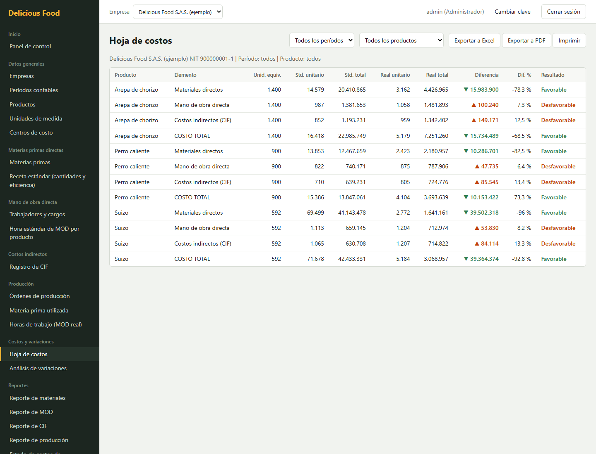</p>

### 🔍 Análisis de variaciones
Aquí está lo más valioso: el sistema descompone la diferencia en **seis variaciones**.

| Variación | Qué te dice | Qué revisar si es desfavorable |
|---|---|---|
| **Precio de materiales** | Pagaste más (o menos) que el precio estándar | Renegociar con el proveedor |
| **Cantidad de materiales** | Usaste más (o menos) material del que permite la receta | Desperdicio o porciones |
| **Tarifa de mano de obra** | La hora costó más (o menos) que la tarifa estándar | Horas extra, cargos mal asignados |
| **Eficiencia de mano de obra** | Se tardó más (o menos) de las horas estándar | El proceso o la capacitación |
| **Presupuesto de CIF** | Los indirectos reales difieren de lo presupuestado | El presupuesto o un gasto atípico |
| **Volumen de CIF** | Se produjo un volumen distinto al presupuestado | Capacidad sin usar |

<p align="center">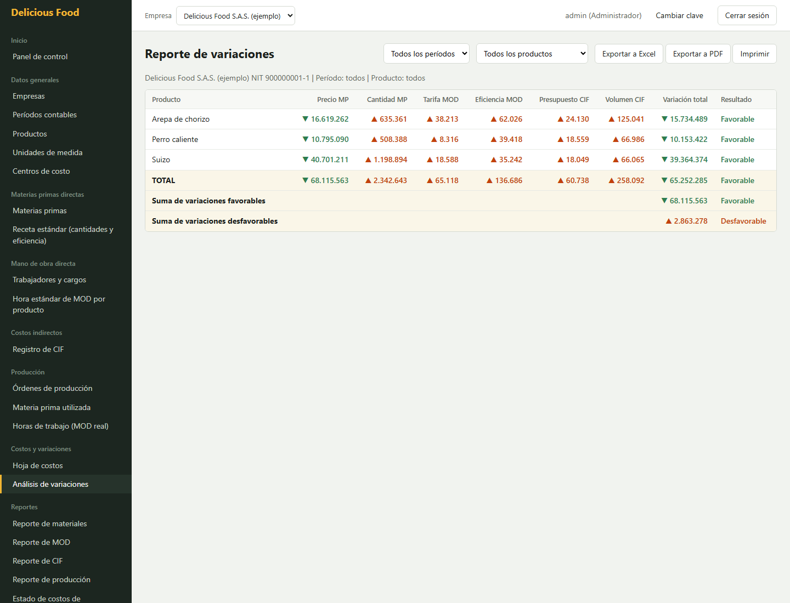</p>

> [!NOTE]
> **Convención de signos:** una variación **positiva** es **desfavorable** (costó más de lo estándar, en rojo). Una **negativa** es **favorable** (costó menos, en verde). El total es la suma de las seis y equivale a *costo real − costo estándar*.

<details>
<summary><b>📐 Ver las fórmulas completas</b></summary>

- **Unidades equivalentes** = terminadas + en proceso × % de avance
- **Cantidad estándar permitida** = cantidad estándar ÷ eficiencia % × unidades equivalentes
- **Variación de precio (MP)** = (precio real − precio estándar) × cantidad real
- **Variación de cantidad (MP)** = (cantidad real − cantidad permitida) × precio estándar
- **Variación de tarifa (MOD)** = (tarifa real − tarifa estándar) × horas reales
- **Variación de eficiencia (MOD)** = (horas reales − horas permitidas) × tarifa estándar
- **CIF aplicado** = tasa × base estándar permitida
- **Variación de presupuesto (CIF)** = CIF real − presupuesto flexible (fijo + tasa variable × base permitida)
- **Variación de volumen (CIF)** = CIF fijo presupuestado − tasa fija × base permitida
- **Margen** = precio × unidades terminadas − costo real de lo terminado

Más detalle en [`docs/MANUAL_TECNICO.md`](docs/MANUAL_TECNICO.md).

</details>

---

## 9 · Reportes y exportación

El menú **Reportes** (y el de *Costos y variaciones*) incluye **7 reportes**:

| Reporte | Dónde está en el menú | Qué muestra |
|---|---|---|
| **Hoja de costos** | Costos y variaciones | Estándar vs. real por producto y elemento del costo |
| **Análisis de variaciones** | Costos y variaciones | Las seis variaciones por orden |
| **Reporte de materiales** | Reportes | Por orden y materia prima: cantidades, precios y variaciones |
| **Reporte de MOD** | Reportes | Por orden y trabajador: horas, tarifas y variaciones |
| **Reporte de CIF** | Reportes | Presupuestado vs. real, tasa y CIF aplicado por período |
| **Reporte de producción** | Reportes | Estado de cada orden y unidades producidas |
| **Estado de costos de producción** | Reportes | Resumen del costo de lo producido |

Cada reporte se puede **filtrar** por período y producto y **exportar** con tres botones:

- **Exportar a Excel** (`.xlsx`)
- **Exportar a PDF**
- **Imprimir**

<p align="center">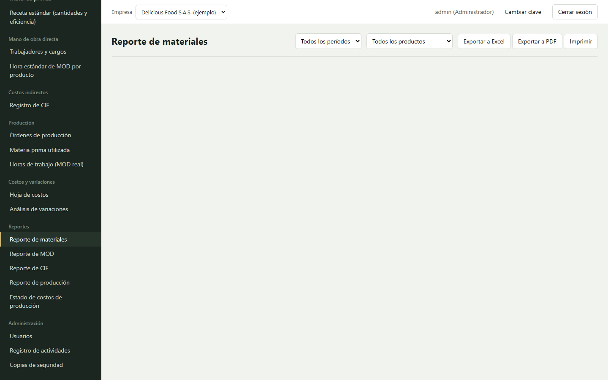</p>
<p align="center"><sub>Ejemplo: Reporte de materiales. Todos los reportes tienen los mismos botones de exportación.</sub></p>

<details>
<summary><b>🖼️ Ver los demás reportes</b></summary>

**Reporte de MOD**

<p align="center">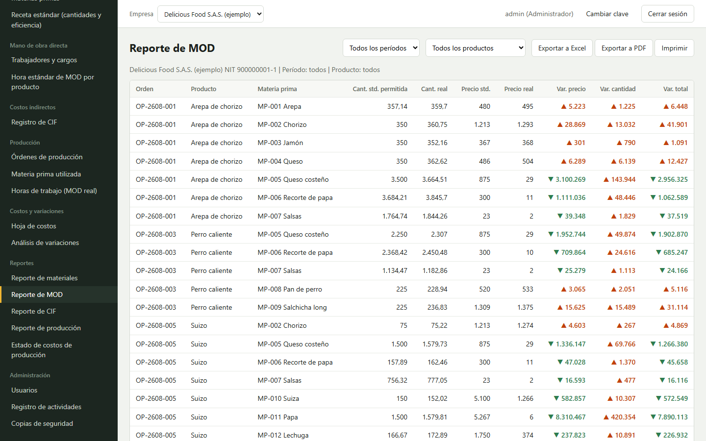</p>

**Reporte de CIF**

<p align="center">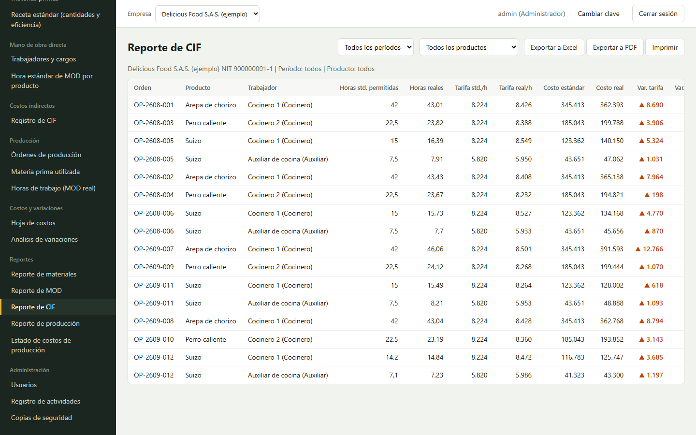</p>

**Reporte de producción**

<p align="center">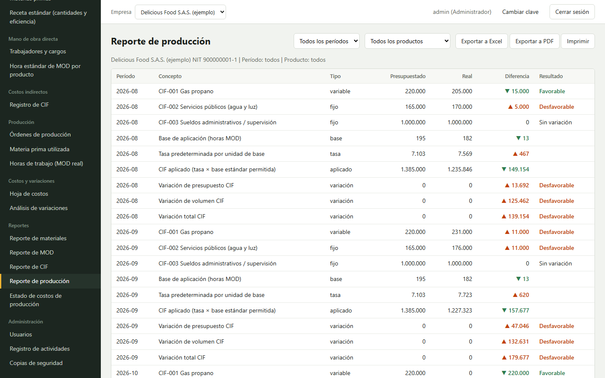</p>

**Estado de costos de producción**

<p align="center">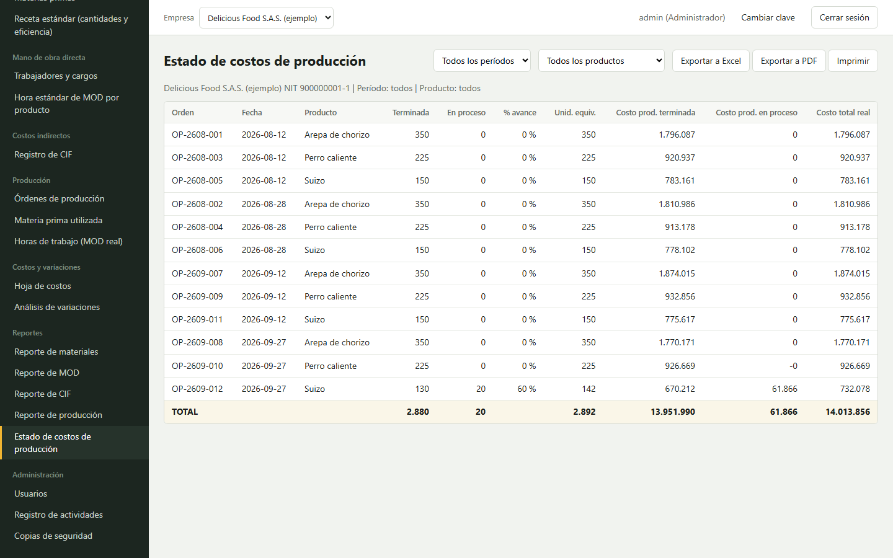</p>

</details>

---

## 10 · Usuarios, roles y registro de actividad

**Administración → Usuarios** (solo administrador): crea cuentas con *usuario*, *nombre completo*, **rol** (*Administrador*, *Usuario* o *Estudiante – solo consulta*), estado *Activo* y contraseña de mínimo 6 caracteres.

<p align="center">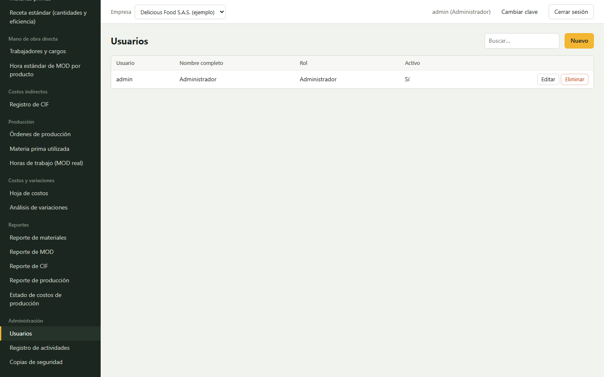</p>

**Administración → Registro de actividades:** guarda **quién hizo qué y cuándo**: inicios y cierres de sesión, intentos fallidos, creación, edición y eliminación de registros, exportaciones y copias de seguridad. Es de solo lectura.

<p align="center">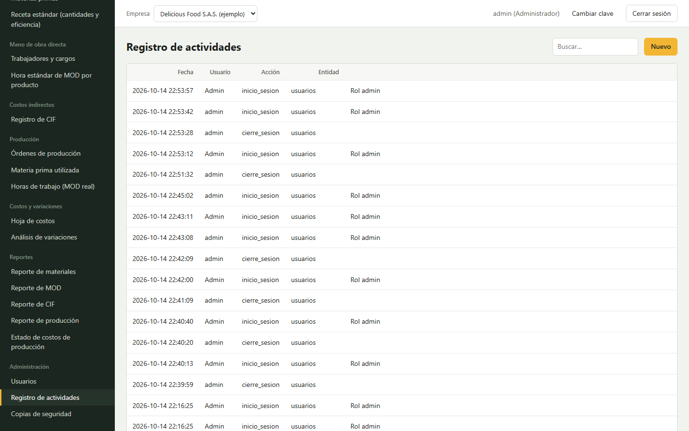</p>

> [!NOTE]
> Un registro que está siendo usado por otros datos (por ejemplo, una materia prima que ya está en una receta) **no se puede eliminar**: el sistema te avisa y te dice qué eliminar primero.

---

## 11 · Copias de seguridad (y cómo pasar datos entre local y web)

**Administración → Copias de seguridad** (solo administrador).

<p align="center">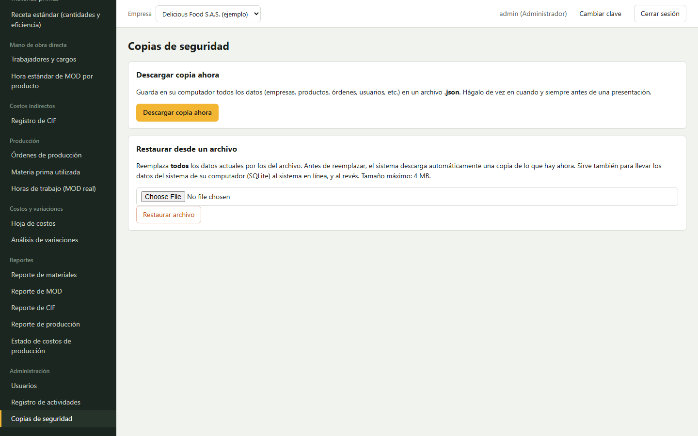</p>

| Acción | Qué hace |
|---|---|
| **Descargar copia ahora** | Guarda **todos** los datos (empresas, productos, órdenes, usuarios…) en un archivo `respaldo-costos-AAAA-MM-DD.json`. |
| **Restaurar desde un archivo** | **Reemplaza todos** los datos actuales por los del `.json`. Antes de reemplazar, el sistema descarga solo una copia de lo que había. Debes escribir `RESTAURAR` para confirmar. |

**Cuándo usarlas**

- 💾 **Antes de actualizar o desinstalar** el programa.
- 🔁 **Para llevar tus datos de local a web (o al revés):** descarga la copia en un lado, entra al otro como `admin` y restáurala. Funciona entre ambas versiones.
- 🛟 **De vez en cuando**, y siempre antes de una presentación. En la web **no hay copias automáticas**.

> [!WARNING]
> - Al restaurar, **los usuarios y contraseñas pasan a ser los del archivo**. Después de restaurar, entra con las claves que tenía el sistema de donde salió la copia.
> - El `.json` incluye las contraseñas (cifradas) de los usuarios: **guárdalo en un lugar seguro** y no lo subas a repositorios públicos.
> - En la web, el archivo puede pesar **hasta 4 MB**.

> [!TIP]
> **¿Le pasaste el programa a otra persona y no ve tus datos?** Es normal: tus datos viven en tu `data\delicious_food.db` y **no viajan con el instalador**. Mándale también tu archivo `.json` y que lo restaure desde *Copias de seguridad*.

---

## 12 · Cómo sacarle el máximo provecho

**Para que el costo sea correcto** (los errores más comunes)

- ✅ **Horas por unidad = el tiempo de *una* unidad**, no el de la tanda.
- ✅ **Horas por mes = las del mes** (192–240), no las de la semana ni los días.
- ✅ **Solo trabajadores que producen** en mano de obra directa.
- ✅ **CIF y base presupuestada del mismo período:** si cargas el arriendo del año pero las unidades de un mes, cada producto carga 12 veces lo que le toca.
- ✅ **Carga todos los costos indirectos.** Con el CIF en cero, el margen sale más alto que el real.
- ✅ **Registra en cada orden TODOS los consumos reales** (materiales y horas), con los precios a los que de verdad compraste.

**Para que sea útil**

- 🔎 **Lee las variaciones de cada orden:** cantidad de materiales desfavorable → revisa desperdicio; precio → renegocia con el proveedor; eficiencia → revisa el proceso.
- 🔄 **Actualiza el costo estándar** cuando suban los insumos o los salarios.
- 💲 **Compara el precio de venta con el costo:** si el margen es bajo, ajusta precio o receta.
- 🗓️ **Cierra el período** cuando termines de registrar sus datos, para que no se modifique por accidente.

**Para cuidar tu información**

- 🔐 Cambia las contraseñas de fábrica.
- 👥 Da a cada persona **solo el rol que necesita**.
- 💾 Haz **copias de seguridad** y guárdalas fuera del computador (memoria USB o la nube).

> [!TIP]
> Para empezar **sin** los datos de ejemplo en local, abre `config\config.ini`, cambia `cargar_datos_ejemplo = true` por `false`, cierra el sistema, borra `data\delicious_food.db` y vuelve a abrirlo. En la web existe la variable `CARGAR_DATOS_EJEMPLO` (ver la guía de despliegue).

---

## 13 · Si algo falla

| Qué ves | Qué hacer |
|---|---|
| **Windows «protegió su PC»** al abrir el instalador | Pulsa **Más información → Ejecutar de todas formas** (el instalador no está firmado digitalmente). Úsalo solo si lo bajaste del Release oficial. |
| **Error de «puerto en uso» / «Address already in use»** | Ya hay otra copia del sistema abierta (otra ventana negra). Ciérrala y vuelve a abrir. Si no, cambia `puerto` en `config\config.ini` (por ejemplo a `8081`) y reinicia. |
| **El navegador no se abre solo** | Escribe en la barra de direcciones: `http://127.0.0.1:8080` |
| **Pantalla en blanco o «no se puede acceder»** | Comprueba que la **ventana negra siga abierta** y recarga la página. |
| **«python» no se reconoce** *(solo en la opción con Python)* | Reinstala Python marcando **Add python.exe to PATH**. |
| **«Su sesión expiró»** | Entra de nuevo (dura 60 minutos sin actividad; también pasa al reiniciar el programa). |
| **Usuario bloqueado** | Espera 1 minuto: tras 5 intentos fallidos el usuario se bloquea temporalmente. |
| **Mis datos «desaparecieron» tras actualizar o mover el programa** | Cada carpeta o instalación tiene **su propio** `data\delicious_food.db`. Si abres el programa desde otra carpeta, empieza con datos de ejemplo. Cierra cualquier copia abierta, abre la correcta y restaura tu copia `.json`. |
| **Web: «No se pudo conectar con la base de datos»** | El servicio de la base está apagado o creándose. Quien administra el sistema debe encenderlo en Aiven. |
| **Web: la primera carga tarda** | Es normal (10–30 s). Espera y recarga. |
| **No me deja eliminar un registro** | Está siendo usado por otros datos (órdenes, recetas, períodos). Elimina primero lo que depende de él. |
| **No me deja guardar una orden** | Revisa que el período esté **abierto**, que la fecha esté **dentro del período** y que haya cantidad terminada o en proceso. |

**Reiniciar la base local desde cero:** cierra el sistema, borra `data\delicious_food.db` y vuelve a abrirlo (⚠️ se pierde todo; haz una copia antes).

---

## 14 · Más información y archivos de ayuda

Estos archivos están en la carpeta [`docs/`](docs/) del repositorio:

| Archivo | Contenido |
|---|---|
| [`docs/MANUAL_TECNICO.md`](docs/MANUAL_TECNICO.md) | Arquitectura, estructura de carpetas, configuración (`config.ini`), modelo de datos, fórmulas, API y validaciones. |
| [`docs/DESPLIEGUE_VERCEL.md`](docs/DESPLIEGUE_VERCEL.md) | Guía paso a paso para publicar tu propia **versión web** (GitHub + Aiven + Vercel). |
| [`docs/DESPLIEGUE_VERCEL.docx`](docs/DESPLIEGUE_VERCEL.docx) | La misma guía en formato Word. |

**Estructura del repositorio**

```text
cost-system/
├─ backend/        Servidor y lógica (Python): API, costos, reportes, exportación
├─ public/         Interfaz web (HTML, CSS y JavaScript, sin librerías externas)
├─ database/       Esquemas: schema.sql (SQLite) y schema_mysql.sql (MySQL)
├─ config/         config.ini con los parámetros del sistema
├─ installer/      Scripts para generar el .exe y el instalador (PyInstaller + Inno Setup)
├─ docs/           Manuales y guías
├─ wsgi.py         Entrada para la versión web (Vercel)
└─ iniciar.bat / iniciar.sh   Arranque rápido en local
```

**Para desarrolladores.** El sistema es Python (solo biblioteca estándar en modo local: `http.server` y `sqlite3`) con una interfaz en HTML, CSS y JavaScript puros: no carga nada de internet. El **mismo código** corre en dos modos: **local con SQLite** y **web con MySQL (Aiven)** en Vercel, que se activa al definir la variable de entorno `DATABASE_URL`. Para generar el instalador, consulta la sección 3.2 del [manual técnico](docs/MANUAL_TECNICO.md).

---

<div align="center">

**Delicious Food · Sistema de Costos Estándar**
*Conoce tu costo. Cuida tu margen.*

[🌐 Versión web](https://cost-system-wine.vercel.app/) · [⬇️ Descargar](https://github.com/BeniaminoC/cost-system/releases/latest) · [📦 Repositorio](https://github.com/BeniaminoC/cost-system)

</div>
